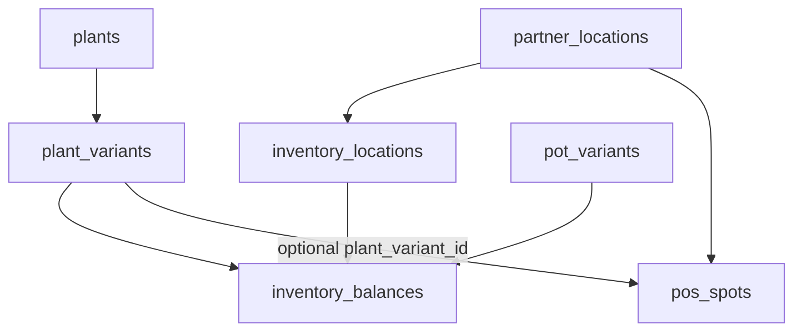

# Catalog / Analytics / Infrastructure architecture plan

Preserved planning for Urban Plant catalog commerce, admin shell, inventory, and analytics. **Not implemented.** Same repository, application, database, Cardcom, and orders. Do not split systems. Do not replace the physical QR flow.

Parent branch: `catalog-analytics-infrastructure-changes`

---

## Locked decisions (V1)

1. No specimen IDs; sellable unit is plant + size (S/M/L).
2. One inventory ledger: quantity per variant (and pot variant) per location.
3. Online catalog sells **central** stock only. Partner-allocated units are not online-sellable.
4. Total owned = sum of locations; catalog available = central − catalog holds.
5. POS QR flow stays; POS sale decrements **partner** qty, not central.
6. Assigning stock to a partner is a transfer (central down, partner up). POS is occupancy, not a second qty.
7. Catalog V1 is **delivery only**. No online pickup. Do not reuse POS pickup → `picked_up`.
8. Product page may show partner availability as information only.
9. Published products stay visible at qty 0 (OOS/disabled). Publish flag ≠ stock.
10. Independent catalog price per size. POS offers remain independent.
11. Pot optional (“no pot” always). Pot inventory follows the same location model. Simple size compatibility.
12. Cart has a quantity selector; holds/validation support qty > 1.
13. No damaged/lost/return/refund workflows in V1 (admin qty adjust is the escape hatch).
14. Catalog QR/source is attribution only; does not change stock, price, fulfillment, or availability.
15. Flowers stay out of the catalog; flower payment behavior stays isolated.
16. Admin moves to a reusable shell; Analytics is the default admin home.
17. Place on POS may transfer 1 from central in the same confirm; refuse if that would invent stock. Bulk/no-POS moves stay on Inventory transfers.
18. Catalog QR attribution uses `partner_locations.public_slug` (`/shop?src=alon-shabo-chlenov`), stored as `source_partner_id`.
19. Extend the current partner / pocket / POS structure; do not create a parallel partner source of truth.
20. Partner monthly revenue is a manual field in V1.
21. Partner notes are one editable text field, not a note history. The visit checklist remains fixed, read-only copy: watering; shelf cleaning when needed and dry-leaf removal; fertilizing and plant-health check; inventory count.
22. Partner plant count is the count of active, non-sold plant POS spots under that partner, using the existing POS status rules.
23. Each pocket shows its active plant total. Opening a pocket groups active POS spots by plant type; each plant-type row shows its count and opens a nested accordion containing those POS spots.
24. The POS records remain the source displayed inside partner pockets; grouping and counts are derived presentation, not a second inventory store.
25. Do not implement new Analytics behavior yet. Revisit Catalog / Inventory / Partner analytics together from the dedicated analytics document.

---

## Open decisions

These do not block Phase A–C:

- **R3. Cardcom `ProductName` for a cart** — default “Urban Plant” or first line + “+N” within 50 characters. Decide at checkout implementation.
- **R4. Write `order_items` for new POS/flower orders in V1?** Recommended **no** in the first checkout phase (smaller flower blast radius). Catalog only. Revisit after catalog payment is stable.

---

## Inventory model

Sellable identity is **plant + size**, not a specimen and not a POS spot.



**Additive tables:**

- **`plant_variants`**: `plant_id`, size `S|M|L`, `catalog_price`, `active`. Unique `(plant_id, size)`. Not every plant has every size.
- **`pots` / `pot_variants`**: same idea; optional on the cart; compatibility by shared size key (S/M/L), not a rules engine.
- **`inventory_locations`**: `kind = central | partner`, optional unique `partner_location_id`. Seed one central row (Urban Plant warehouse). Create a partner location row when a partner is created (or lazily on first transfer). Do **not** fake the warehouse as a `partner_locations` row.
- **`inventory_balances`**: one row per `(location_id, item_kind, item_id)` with `quantity >= 0`. `item_kind` is `plant_variant` or `pot_variant`. **This is the stock source of truth.**
- **`catalog_stock_holds`**: reservations against **central** balances only. Independent of `pos_spots.status`.
- **`order_items`**: catalog (and later optionally POS) line snapshots.
- Optional **`inventory_movements`** log (transfer, catalog_sale, pos_sale, admin_adjust) for drift debugging. No `damaged` / `returned` enums in V1.

**Do not:**

- Track specimen IDs or per-plant lifecycle tables.
- Treat `plants.average_size` as a SKU (display/care field only, including `x-large`).
- Put catalog quantity on `offers` or `pos_spots`.
- Derive partner quantity from counting POS spots.
- Put flowers into variants/balances in V1.

POS offers stay independent: plant + `consumer_price` for QR checkout. Catalog prices live on `plant_variants.catalog_price`.

---

## POS relationship

Today a POS spot knows **plant type** via `current_offer_id` → `offers.product_id`. It does **not** know size.

**POS remains the QR / unique-unit sales channel.** It is not a quantity store.

**Required link (nullable for flowers and legacy rows):** `pos_spots.plant_variant_id` → `plant_variants.id`

- Flowers: leave null; no balance writes; skip-checkout / no-hold / reusable POS unchanged.
- Legacy plant spots: null until admin assigns a size; QR checkout must still work.
- New/updated **plant** POS assignments: **require** a variant whose `plant_id` matches the offer’s product.

**Occupancy rule:** at partner location L, for variant V:

`count(pos_spots where plant_variant_id = V, partner = L, status in available|held_for_payment) <= inventory_balances.quantity`

Sold/inactive spots do not occupy stock.

| Event | Balances | POS |
|---|---|---|
| Admin transfer N from central → Alon Shabo | central −N, Alon Shabo +N | unchanged |
| Place variant on POS at Alon Shabo | If partner qty already covers occupancy+1, only occupy. Else **one confirm transfers 1 from central** then occupy. Refuse if central is 0 and partner has no spare qty. | `plant_variant_id` + offer set; status available |
| POS QR sale (plants) | Alon Shabo −1; total owned −1; **central unchanged** | existing hold → `sold` |
| Catalog sale | central −N after verified payment; partners unchanged | untouched |
| Flower QR sale | no balance write | POS stays `available` |

**Place on POS** is a single confirm that may transfer 1 from central. Never invent stock. Standalone Inventory transfers remain for moving N>1 or moving stock without a POS.

**POS payment must not fail because inventory drifted.** Finalize even if `plant_variant_id` is null or partner qty is already 0. Decrement when the row exists and qty ≥ 1; otherwise log.

**Pots on physical QR:** V1 does **not** decrement pot balances on POS sale.

**Flower safety:** inventory UPDATE must be gated on `inventory_type <> 'flowers'` and `plant_variant_id IS NOT NULL`. Do not add catalog branches inside `lib/startCardcomPaymentPrep.ts`.

---

## Catalog availability rules

For variant V:

- `owned_at(location)` = `inventory_balances.quantity` (0 if no row)
- `total_owned(V)` = sum over all locations
- `online_on_hand(V)` = quantity at the **single central** location
- `online_held(V)` = sum of **active** `catalog_stock_holds.quantity` for V at central
- **`online_available(V) = max(0, online_on_hand − online_held)`**

Catalog add-to-cart / qty stepper / payment start all use `online_available`. Partner quantities never enter that formula.

Example: central 8, Alon Shabo 1, Golda 1 → total owned 10, catalog available 8.

Same formula for pot variants (central only for catalog).

**Visibility ≠ stock:** a published plant with no online stock still appears. `plants.catalog_published` hides a type intentionally. `plant_variants.active` hides a size. Quantity 0 does neither.

By **plant + size** (variant id):

- Catalog CTA / stepper: `online_available(variant)`.
- Out of stock: still render size, disabled, cannot add.
- Informational store list: partner locations with `quantity > 0` for that variant. No reservation, no pickup, no fulfillment change.

---

## Catalog holds

Reuse the **17-minute TTL idea**, not the POS row.

**Hold rows; do not decrement `quantity` until verified payment.** Owned stock must not lie during unpaid checkout. Available is `on_hand − active_holds`.

**Acquire** (same DB transaction as inserting `payment_attempts`):

1. Lock the central balance row.
2. Compute `online_available`.
3. If `available >= requested`, insert `catalog_stock_holds` (attempt_id, item, qty, expires_at = now+17m, status active).
4. Else reject (do not create Cardcom session).

Race (A wants 6, B wants 4, on_hand 8): the second acquire sees 8−6=2 and fails.

**Expire:** extend the existing expire-payment-holds cron to mark stale catalog holds `released` and expire the attempt. Do not touch `pos_spots`. Flower attempt expiry stays as it is.

**Success:** catalog finalize decrements central `quantity` by held qty, marks holds `consumed`, inserts order + items.

**Cancel / fail / prep failure:** release holds; quantity unchanged.

**Late payment after expiry:** `needs_reconciliation`, no order, no decrement.

**Quantity in cart:** line `Monstera M × 4` is one hold of 4.

Do not write catalog holds onto `pos_spots`, and do not write POS holds into `catalog_stock_holds`.

---

## Catalog checkout

Two flows, shared Cardcom kernel, **no** `if (catalog)` sprawl inside POS prep.

**POS / flowers (unchanged):** `/checkout/pos/:slug` → existing `startCardcomPaymentPrep` → existing POS finalize.

**Catalog:**

```
/shop → cart → /checkout/shop (delivery only)
  → startCatalogCardcomPaymentPrep
       persist line snapshot on payment_attempt
       acquire catalog holds on central stock
       Cardcom LowProfile/Create (single Amount = sum, ProductName ≤ 50)
  → webhook GetLpResult
  → catalog finalize (not the POS CTE)
       insert orders + order_items
       consume holds, decrement central qty
       fulfillment_method = delivery, order_status = sold
       pos_spot_id null
```

- `payment_attempts.pos_spot_id` becomes nullable. POS path still requires it. Catalog path forbids it.
- Snapshot includes `channel: catalog`, `lines[]`, optional `source_partner_id`.
- `orders.price` = total. Header `product_id` / `product_name` for catalog: first plant line (or summary); **items table is authoritative**.
- Historical POS/flower orders: no `order_items` rows; UI falls back to header columns.
- Browser never trusted for prices. Webhook compares charged amount to `attempt.amount`.
- Documents: extend Cardcom `Products[]` to real lines. POS/flower documents stay one line.
- Fail/retry URLs return to catalog checkout, not `/checkout/pos/:slug`.

Public routes: `/shop`, `/shop/plants/[plantId]`, `/cart`, `/checkout/shop`. Reuse plant presentational components; do not mount `PosPlantLanding` as the catalog page.

---

## Admin shell

Current: `app/admin/layout.tsx` only overlays language + sign-out. `app/admin/page.tsx` is a card index. No shared nav.

**Minimal shell (no UI kit):**

- `lib/adminNav.ts` — Analytics, Orders, Offers, Catalog, Inventory, Partners / POS.
- `components/admin/AdminShell.tsx` — top bar, top-left hamburger, drawer/sidebar, overlay, Escape/focus trap.
- Wrap children in `app/admin/layout.tsx`.
- **`/admin` → redirect to `/admin/analytics`.**

**New admin surfaces (minimum):**

- **Catalog:** plant publish flag, variants (size, catalog price, active), pots, compatibility, images/care.
- **Inventory:** balances by variant × location, total owned, online available, transfer central ↔ partner, admin adjust qty.
- **Partners / POS:** plant offer assignment requires size/variant; occupancy check; Place on POS may transfer 1 from central. Flowers unchanged.

---

## QR attribution

Catalog must work from a generic shared URL and from a partner QR.

- Generic: `/shop`
- Partner QR: `/shop?src=alon-shabo-chlenov` via `partner_locations.public_slug`
- Resolve slug → partner id; ignore unknown `src`
- Store `source_partner_id` on the attempt/order snapshot
- **Do not** let source change stock, price, fulfillment, or availability in V1
- Catalog analytics must use `channel: catalog` and must **not** emit `pos_scan`

---

## Branch strategy

```
master
  └── catalog-analytics-infrastructure-changes    long-lived parent
        ├── catalog/admin-shell
        ├── catalog/inventory-model
        ├── catalog/admin-catalog-inventory
        ├── catalog/catalog-ui
        ├── catalog/cart
        ├── catalog/checkout
        ├── catalog/post-purchase
        └── catalog/analytics
```

- Cut this parent from `master` once; merge **into** it, not the reverse, until a slice is explicitly shipped.
- Each phase is a short child branch from latest parent, reviewed, merged back to the parent.
- Sync: merge `master` into this parent after every production deploy (or before a new phase). Prefer merge commits over rebase on the shared parent.
- Do not force-push the parent.
- Do not merge this parent into `master` until a phase is production-safe.
- Keep POS/flower files untouched unless a phase needs a narrow additive hook (nullable column, extra CTE that flowers skip).

Child feature branches are **not** created in this planning commit.

---

## Phased implementation

Each phase leaves production valid. Review before the next. No feature implementation in this commit.

### Phase A — Admin shell

Hamburger + sidebar; `/admin` → analytics. No DB. All customer flows unchanged.

### Phase B — Inventory data model

Variants, locations, balances, holds table, `order_items`, nullable `payment_attempts.pos_spot_id`, nullable `pos_spots.plant_variant_id`. Helpers + occupancy SQL. No customer behavior change.

### Phase C — Admin catalog + inventory + POS variant assign

Sizes/prices, publish flags, balances, transfers; plant POS assign requires variant; Place on POS may transfer 1 from central; occupancy cannot exceed partner qty. Customer QR unchanged.

### Phase D — Catalog UI

`/shop` and `/shop/plants/[plantId]`. OOS visible/disabled. Also-available-at from partner qty. No `pos_scan`.

### Phase E — Cart

`/cart`, qty stepper capped by `online_available`. Pots optional including “no pot”.

### Phase F — Catalog checkout / payment

Delivery-only. Separate prep + finalize. Holds before Cardcom. POS/flower files not turned into catalog conditionals.

### Phase G — Post-purchase

Success, email, admin order lines. Historical orders header-only.

### Phase H — Analytics + catalog QR

`channel: catalog`. `public_slug`. Printable `/shop` and `/shop?src=...` attribution only.

**Rollback:** disable new routes first. Schema is additive. Never roll back POS hold/finalize to “fix” catalog.

---

## Regression risks (for later implementation)

**Highest:** flower skip-checkout / no-hold / reusable POS / `"פרחים"` / email skip; plant POS holds; POS QR still purchasable without `plant_variant_id`; inventory decrement on flowers or on central during POS sale; blocking POS payment when partner qty is missing; catalog emitting `pos_scan`; Neon purchase KPIs that filter Alon Shabo partners (catalog orders with null partner will not appear).

**Must keep green later:** `verify-flowers-phase1.ts`, `verify-payment-prep.ts`, `verify-payment-hold-lifecycle.ts`, `verify-pos-spot-hold.ts`, `verify-cardcom-webhook.ts`.
